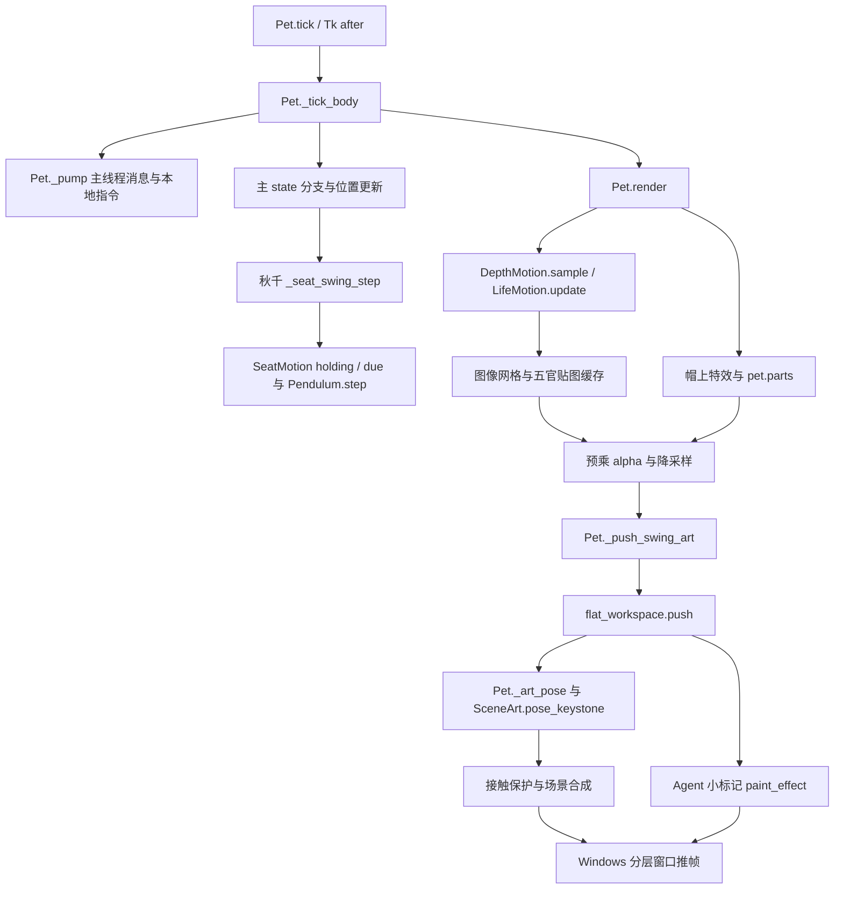
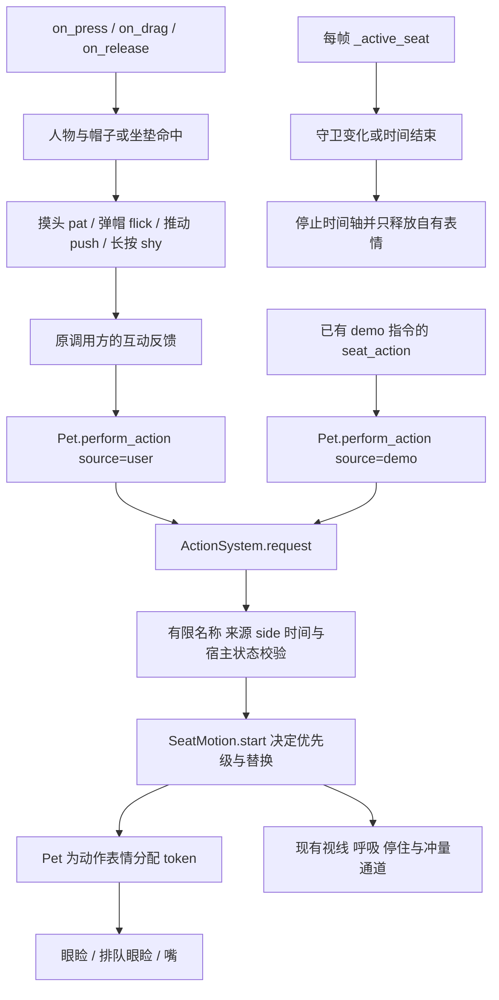
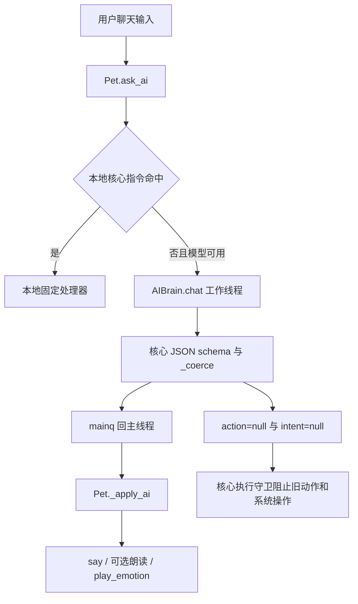
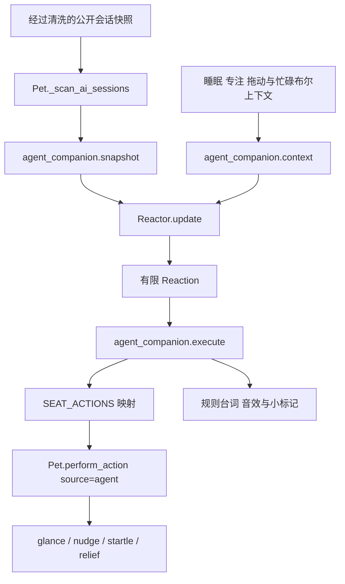
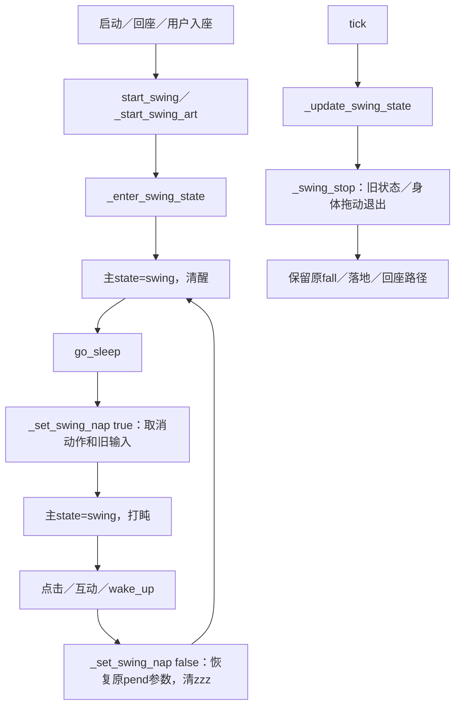
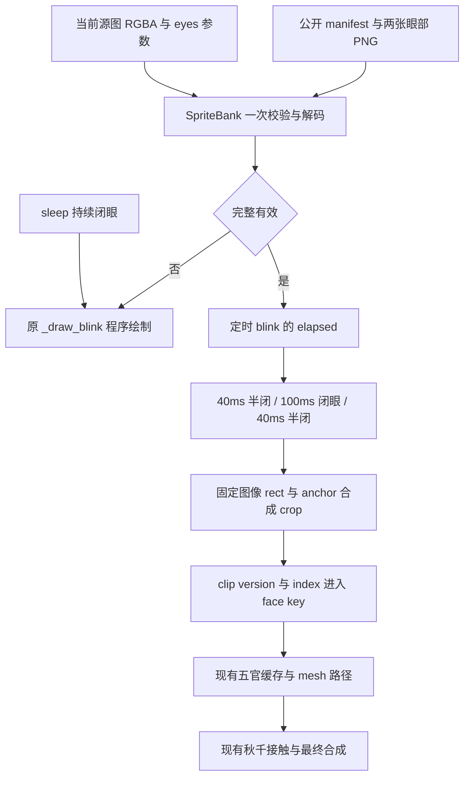
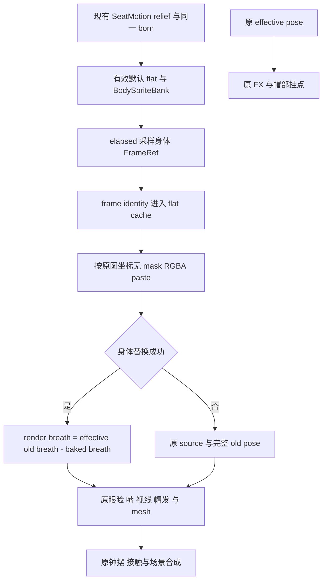

# Hybrid 动画架构评估与决策记录

Phase 1A 已建立八个秋千坐姿动作的统一 Action 入口，Phase 1B 已整理秋千／打盹的生命周期边界。Phase 2A 已完成首个局部眨眼 PNG clip 的协议与接线验证，并恢复正常桌面实例。主运动状态机没有整体迁移，八个坐姿主动作仍使用现有程序通道；姿态、物理、Effects 和模型权限保持原边界。

当前 Phase 2B1（I-44）只把 `relief` 的胸肩呼吸通道烘焙为 PNG，其他动作通道继续实时处理。隔离功能检查、模拟生产合成与真机接线／恢复已通过；性能仍为 INCONCLUSIVE，不能据此宣称主动作已经全部 Sprite 化或性能目标已达到。

日期：2026-10-08。对应问题：[I-41／I-42／I-43／I-44](DESIGN_ISSUES.md)。ADR-001 的 Action 入口与 ADR-002 的秋千生命周期为已完成的窄边界；ADR-003 记录局部眨眼 clip；ADR-004 的身体呼吸通道功能接线通过，性能未闭合。其余未实施路线为 **Proposed**。架构决策状态与[迭代验收](DESIGN_ITERATIONS.md)的 ACCEPT / REJECT / INCONCLUSIVE 分开记录，各轮测试和桌面证据不得混用。

## 真实目录与现有能力

| 路径 | 当前职责与边界 |
| --- | --- |
| [pet.py](../../pet.py) | 日常入口；主状态、Tk 鼠标、聊天窗口、场景、短表情、主循环与 Windows 分层窗口仍集中在 `Pet` |
| [character_actions.py](../../character_actions.py) | Phase 1A 的纯逻辑请求边界：`ActionContext`、`ActionResult`、`ActionSystem`；只处理坐姿动作子层 |
| [sprite_animation.py](../../sprite_animation.py) | Phase 2A 的 `SpriteBank` 与 Phase 2B1 的独立 `BodySpriteBank`：资源校验、按 elapsed 采样、有限缓存；两套 manifest 与白名单分开，不接管主运动 |
| [seat_motion.py](../../seat_motion.py) | 八个固定动作的时间轴、优先级、缓入缓出、到点一次性冲量；唯一的坐姿时间与优先级所有者 |
| [life.py](../../life.py) | 有限弹簧、惯性与秋千钟摆；保留现有参数和约束 |
| [depth_model.py](../../depth_model.py)、[scene_art.py](../../scene_art.py) | 图像网格、刚性脸部位移、帽发局部位移、呼吸、接触保护与缓存 |
| [flat_workspace.py](../../flat_workspace.py) | 当前角色与工作台的最终场景合成，调用 `SceneArt.pose_keystone` |
| [ai_chat.py](../../ai_chat.py) | 可选角色聊天模型、有限 JSON 输出与本地聊天记忆；不负责观察其他 Agent 的工作状态 |
| [agent_reactions.py](../../agent_reactions.py)、[agent_companion.py](../../agent_companion.py) | 公开会话状态驱动的陪伴规则与动画接线；不调用聊天模型，不读任务正文 |
| [fx.py](../../fx.py)、[hat_fx.py](../../hat_fx.py) | 特效预烘焙与帽上固定池；不能把所有粒子都视为这个模块管理 |
| [assets/](../../assets) | 现有角色单图、场景图层、表达贴图、特效精灵与音频；公开素材与无密钥配置示例 |
| [tests/](../../tests)、[tools/](../../tools) | 隔离回归、合成数据预览、诊断与制作工具；不是第二套生产引擎 |
| [house3d/](../../house3d) | 独立 Godot 实验；不进入默认桌宠的本轮改造 |

### Sprite 路线的实际程度

当前 `Pet.rebuild_scale_cache` 把 `assets/main.png` 缩放为 `spr2`，建立 `DepthWarp`，并在素材存在时处理帽、发、腿等可选图层。`assets/expr/` 与 `assets/emotions.json` 提供表达贴纸；2026-10-11 分发更新恢复默认开启并增加设置开关，一次迁移旧默认关闭值。AI 外观不显示小乔贴纸。短眼睑和嘴形仍可走程序绘制。`assets/scene/` 提供当前秋千场景图层与元数据。

I-41／I-42 基线只有图像资源、姿态缓存和有限时间轴，没有角色连续动作 clip。Phase 2A 引入的是一个 180ms 的眼部局部 PNG clip，其 schema 和播放范围只覆盖这个表情，不代表已有走跳或八坐姿主动作素材、通用角色播放器。`seat_motion.ACTIONS` 仍是程序通道时间轴。不能据此宣称“Sprite 主动作已完成 80%”，也不能把旧表情包当成当前角色的新动作素材。

Phase 2B1 的预制部分也仅为 `relief` 的胸肩 `breath` 通道；视线、短表情、帽发与钟摆仍沿用当前实时链路。这是单个动作的一部分资源化，不是完整身体帧动画或新的角色骨骼。

## 当前调用链

### 主循环、姿态与渲染

`Pet.tick`（约 9141 行）调度 `_tick_body`；隐藏到托盘时只泵消息。秋千钟摆推进在 `_tick_body` 的 `swing` 分支中，使用 `_seat_swing_step`（约 6890 行）。`LifeMotion.update` 与部分深度采样仍由 `render`（约 10599 行）驱动。当前渲染不是只读快照：姿态采样、物理推进、短表情过期与部分特效状态仍分布在渲染路径。

`_art_pose`（约 6730 行）混合基础视线、坐姿通道与帽发惯性，并量化成缓存键；`_push_swing_art`（约 7159 行）把默认平面场景交给 `flat_workspace.push`。`SceneArt.contact_gate`（约 193 行）保护握绳手、绳、膝腿与坐垫等接触位置；脸部使用整体平移，不通过橡皮变形制造动作。

### 鼠标、演示与本轮 Action 入口

鼠标入口保留原来的命中、慢拖判定、长按与叫醒流程。`_seat_head_click`、`_seat_hat_click`、`_seat_push`、`_seat_long_press` 通过 `Pet.perform_action` 请求动作，奖励、台词、音效和真实推动反馈仍由这些调用方决定。

`_exec_cmd` 的现有 `demo` 分支（约 9045 行）也走同一入口。它只临时展示模拟状态，`push` 在调用方施加同一有限钟摆冲量，不走用户音效或奖励路径。演示不唤醒睡眠、不修改偏好、不调用模型；界面保留“模拟”，到期恢复真实工作台。演示不是模型权限，也不是新的通用动画控制指令。

### 角色聊天 LLM：当前只有回复与有限情绪

`Pet.ask_ai`（约 5211 行）先处理有限本地核心指令，未命中才考虑模型；`AIBrain._schema`（约 634 行）在核心档要求 `say`、有限 `emotion`，以及 `action=null`、`intent=null`。模型自动函数调用关闭。`_coerce`（约 341 行）仅返回固定四字段，未知字段不会传给角色；它保留旧兼容动作解析，因此执行端仍需核心守卫。

`Pet._apply_ai`（约 5304 行）处理回复、可选朗读与有限情绪。核心档同时阻止 `_do_action`、`run_agent` 与旧主动搭话执行链。本轮 `source='agent'` 指本地陪伴规则，不指聊天 LLM；没有把模型接到 `perform_action`。

没有对模型开放位移、角度、速度、幅度、原始 transform、任意时间轴或素材路径。旧 `_play_timeline` 内部可以对固定轨道执行 `setattr`，但它不是模型接口；旧 `transform` 指令也被核心 IPC 白名单挡住，函数本身另有核心守卫。

### Agent 工作状态：独立的本地规则链

`_scan_ai_sessions`（约 5868 行）周期更新公开状态；`agent_companion.snapshot` 只向规则提供会话标识、来源标签与状态，过期记录按 idle 处理，不提供任务正文、聊天或错误全文。`Reactor.update` 是纯规则，首批快照建立基线，等待时长、运行时长、静音与冷却决定反应。工作流的方向标签不等于动画控制指令。

`SEAT_ACTIONS` 映射开工→`glance`、等待→`nudge`、出错转入→`startle`、完成→`relief`。默认 `few` 仅允许等待／出错类；`normal` 才有开工和完成类。陈旧记录不会被当作成功完成。规则可以产生台词或场景小标记，但不能以陪伴反馈批准外部 Agent 的操作。

## A / B / C / D 评估

| 分类 | 已核查事实 | 处理方向 |
| --- | --- | --- |
| A：已经符合 | Sprite 图像与 Procedural 网格共同工作；帽发弹簧和钟摆有限；脸与接触受保护；帽特效预烘焙、有数量上限；模型字段有限；Agent 规则独立 | 保留这些边界。本轮补上八个坐姿动作的统一 Action 请求与表情归属 |
| B：应保留 | `pet.py` 日常入口、`pet.ASSETS` 路径、固定动作通道、现有缓存和降级、鼠标反馈与用户奖励、主状态和打盹语义 | 保持启动、hook、打包和存档兼容；`start_seat_action` 留作兼容包装 |
| C：逐步改造 | 无真实角色 clips；主状态通过字符串与分支修改；物理／采样仍部分位于 render；姿态限幅分散；三套 Effects 没有统一语义入口 | 每阶段有单独问题、基线和验收。先入口，后主状态，再 clip、最终姿态约束与更新／绘制拆分 |
| D：耦合风险 | 坐姿打盹仍是 `state='swing'`；眼睑可排队；同一帧有不同采样时刻；量化影响幅度和缓存；聊天与 Agent 完成语义不同；物理反馈与奖励共用调用方 | 不建立第二个主 FSM，不增加时间所有者；取消必须丢弃排队表情；不靠缓存成绩证明冷帧预算，不靠效果推断任务成功 |

## ADR-001：先统一坐姿 Action 入口

### 背景与决定

现有八个坐姿动作可以沿用已经可见的通道。主要问题是不同入口分散处理合法名、来源、宿主状态、替换与短表情，容易在睡眠、拖动或减少动画后补播旧表情，或被低优先级提醒覆盖用户摸头。

**Accepted：本轮仅新增坐姿子层的 Action 请求边界。** `ActionSystem` 使用宿主提供的 `ActionContext` 与时间，对请求进行校验，把已接受的请求交给同一个 `SeatMotion`。`SeatMotion` 仍是时间、优先级和一次性事件的唯一所有者。`blocked / playing / idle` 只是坐姿子层的诊断状态，不是 `Pet.state` 的替代，也不是新的主 movement FSM。

选择薄包装是因为它可以在不改姿态、物理、特效或素材的情况下约束调用边界。不引入 ECS、IK、全骨骼引擎或新的依赖。后续主状态接口与 clip 路线为 **Proposed**，需要独立实现与验收。

### 本轮改了什么（What I changed）

- 新增纯逻辑 `ActionContext`，包含 movement、是否有秋千、睡眠、减少动画、拖动与唱歌上下文；不包含像素、幅度、速度、资源、Effects 或模型文本。
- 新增 `ActionResult` 与 `ActionSystem.request / active / snapshot`。未知／畸形动作、来源、时间或方向安全拒绝；诊断只保存有限公开词汇，不保存任意输入。`snapshot` 不修改正在播放的时间轴。
- `Pet.perform_action(name, source='user', side=1)` 成为鼠标、Agent 规则与 demo 的共同入口。当前 `Pet` 包装返回布尔值，详细拒绝原因保存在 `ActionSystem.last_request`；不能把它误写成所有调用方都直接获得 `ActionResult`。
- 来源仅为 `user / agent / demo`，方向仅为 `-1 / 1`；`agent` 只允许四个陪伴动作，其余四个保留给用户或演示。优先级由动作规格决定，不因来源名称自动提高。
- 保留 `start_seat_action(name, side=1)`，内部转调 `perform_action`，不绕过校验。
- 宿主为动作眼睑、排队眼睑与嘴分配 token；结束、取消或被新动作替换时只释放该动作仍拥有的覆盖层，保留无关的聊天情绪和正常眼睑缓回过程。

### 为什么改（Why）

同一个校验与取消策略使用户互动、规则反应和演示遵守相同的坐姿限制。拒绝低优先级请求不修改当前动作；上下文变为睡眠、拖动、减少动画、唱歌或离开秋千时取消旧时间轴，恢复条件后不继续旧动作，也不让原动作排队眼睑在醒来后补播。

表情 token 解决的是归属问题：动作停止时可以清理自己的短表情，而不能擦掉后来聊天产生的眼睑。这不会改变聊天模型情绪协议，也不尝试建立通用情绪调度器。

### 生产文件（Files changed）

| 本轮文件 | 变化 |
| --- | --- |
| [character_actions.py](../../character_actions.py) | 新增纯逻辑请求校验、状态守卫、诊断结果与取消包装 |
| [pet.py](../../pet.py) | 接入 `perform_action`，统一三种来源，保留旧入口；动作表情 token 的设置、转移与清理 |
| [agent_companion.py](../../agent_companion.py) | 已有坐姿映射通过 `perform_action(..., source='agent')` 请求；用户高优先级动作继续占有自己的表情 |

本轮仅改这三个生产文件。此前 I-40 的 `seat_motion.py`、动作预览和动作内容不是本 ADR 新增的视觉能力。本轮不改 pose、物理、FX、模型、schema 或素材，不新增依赖。验证文件见[纯逻辑 Action 测试](../../tests/test_character_actions.py)与[生产接线测试](../../tests/test_action_api_runtime.py)。

### 架构影响（Architecture impact）

请求入口现在有稳定的有限边界，宿主仍负责选择上下文与实际播放。用户奖励、台词、音效和 `push` 的物理反馈留在原调用方，避免一个通用请求隐式奖励用户或产生演示声音。demo 保持静音、无奖励、无真实数据写入。

主 `Pet.state`、生命周期、窗口和渲染职责没有迁移。现有 `SeatMotion`、`LifeMotion`、`Pendulum`、`DepthWarp`、`SceneArt` 与缓存继续工作；因此本轮不能作为完整 Hybrid 架构已完成、帧耗已下降或动作明显变丰富的依据。

### 风险（Risks）

1. `ActionContext.on_swing` 当前只说明宿主有秋千对象，不是完整的素材能力清单。缺失 scene／rig 时，某些被接受的通道仍可能不可见；后续 clip／能力层需区分“请求合法”和“资源可播放”。
2. token 只管理本轮动作产生的短表情。旧代码直接写眼睑／嘴时必须解除或转移归属，防止动作退出清理不属于它的新表达。排队表情提升到当前眼睑时必须保留 token。
3. 同一帧新指令起点可能晚于帧采样时刻。保留已有 SeatMotion 负年龄处理：新动作不在出生时过期，尚未到点的冲量不提前触发。
4. `push` 的物理推动仍由用户／demo 调用方承担。未来适配新动作时不能把推动同时放在入口和调用方，造成两次冲量；也不能漏掉真实触摸与静音演示的区别。
5. I-40 已记录真实尺寸与冷网格成本的未闭合项。本轮入口改造不消除它们，也不能使用缓存后的低耗时宣称首遍性能已达标。

### 要测什么（What to test）

本轮正式隔离入口已验证：**544 项单元检查通过，failure / error / skip 均为 0；脚本式 `test_pet` 为 186 / 186**。新增 25 项纯契约测试与 10 项当前核心壳生命周期测试，未调用真实模型或读取个人运行数据。实际桌面PID6864以普通pet.py启动（未保留debug-state）；1.0档8个命名模拟动作逐个观测到playing/accepted，最后恢复idle子层、真实live工作台和紧凑聊天。生产源码hash与验证副本匹配，当前滑动帧耗快照26.42ms，不作为性能p95或全程预算证明。证据与完整结果见[本轮I-41记录](DESIGN_ITERATIONS.md)。本轮未新增或修改姿态数值；0.76档实际点击/表情竞争仍建议用户复核，不以历史I-40预览冒充本轮测试。

首轮保留并执行了既有“打盹拒绝不建立宿主时间轴”的兼容断言；实现改为惰性绑定后通过，未修改该断言掩盖失败。独立审核发现的离座清理缺口已闭合：`_swing_stop` 即时取消，每状态更新与五官采样共同保证释放动作自己的覆盖层。`snapshot` 为只读，`_write_state` 不改变动画。

与本轮可恢复基线的 AST 对比确认 `_art_pose / _seat_swing_step / render / _push_swing / _push_swing_art` 完全相同；`seat_motion.py` 的 SHA256 未变。这支持本轮未改变姿态与物理实现的范围说明，不代表这些路径的既有性能风险已关闭。

| 验证范围 | 必须观察的结果 |
| --- | --- |
| 有限协议 | 八个合法名可请求；未知、非字符串、非法来源／时间／side 安全拒绝，不中断当前动作，不保留任意文本 |
| 来源与优先级 | Agent 只能四个陪伴动作；摸头等优先于 Agent；同级替换与过期后新请求仍由 SeatMotion 决定 |
| 取消 | 睡眠、减少动画、拖动、唱歌、离开秋千取消动作；恢复后无旧冲量、停住窗口或表情补播 |
| 表情所有权 | 当前眼睑、排队眼睑、嘴均正确释放；排队提升保留 token；无关聊天情绪不被清掉；替换清旧动作不伤新动作 |
| 兼容与演示 | `start_seat_action` 走同一守卫；demo 静音、无奖励、无偏好写入、无模型调用，并恢复真实工作台 |
| 必需回归 | 隔离入口运行 `test_pet / test_life / test_swing / test_session_lights / test_ai_lights_data`，加当前核心、Action、坐姿与陪伴定向测试；区分脚本断言、unittest 数量和 skip 原因 |
| 实际桌面 | 1.0 / 0.76 尺寸下复核接触、脸、醒后、慢拖／长按、动作竞争与窗口恢复；离线模拟图不得冒充真实截图 |

从根目录使用 `py tools/run_checks.py`，按[开发指南](../DEVELOPMENT.md)隔离测试与真实数据。文档与公开文件检查另外执行，不能代替动作验收。

## 五阶段渐进计划

### Phase 1：动作入口与主运动状态职责

**1A，本轮：坐姿 Action API。** 仅采用本 ADR 的入口与表情归属。保留八个动作通道和同一 `SeatMotion`；完成上述回归与桌面恢复后记录本轮验收结果。

**1B，本轮 Accepted：秋千生命周期边界。** 只为现有秋千建立进入、每帧一致性检查、退出和打盹切换的窄边界，继续以 `state / _swing / _nap_on_swing` 为唯一事实来源。没有新的并行FSM，也没有一次迁移全部主movement分支。

#### ADR-002：先迁秋千与打盹边界（I-42）

**背景。** 入盹、唤醒、离座原来分别维护同一标记、钟摆参数和zzz。同一主线程回合先sleep再wake，下一帧看不到nap，旧坐姿动作可能继续。释放后60ms的点击回调也可能跨过入睡或场景替换，旧长按对象在离座后仍有效；清醒时再次wake原来会误改idle，下一帧拆掉场景。

**选择与决策。** 采用Pet内四个小hook，保留原公共入口与同一主状态。另一选择是新增完整状态机并迁移所有state赋值，当前风险和范围过大；另建只记录秋千状态的管理器会重复事实来源。因此不增加类、引擎、依赖或动画资源。

| Hook | 实际职责 |
| --- | --- |
| `_enter_swing_state` | 两种现有场景构建器共用进入边界；保留构建出的scene，清孤立nap标记 |
| `_set_swing_nap` | awake/nap切换，统一原`.085/.30`与`.012/.85`参数；保留theta/omega，醒时只清zzz |
| `_update_swing_state` | tick原位置检查外部状态或身体拖动导致的退出；清孤立nap，不重复物理推进 |
| `_swing_stop` | 唯一秋千退出hook；先恢复旧pend再解绑，清动作自有overlay、拖动对象与预约输入，保留原自然落地／回座计时 |

**可恢复和优先级。** 入盹同步取消Action，醒来不会补播旧动作；清醒wake幂等，保留当前动作和场景。入盹与离座清`_scene_drag`并推进`click_token`，令真实60ms/900ms预约回调失效。移动中的场景拖动优先于sleep；普通场景拖动保持入座，第一次点击唤醒不预约长按。唱歌和身体拖动沿用原守卫。

**影响与限制。** 生产仅修改`pet.py`，定向回归用`tests/test_swing_lifecycle.py`合成当前核心的art/flat/程序场景并运行实际鼠标预约回调。`render / _art_pose / _seat_swing_step / _push_swing / _push_swing_art / on_press / on_drag / on_release / _frame_delay`保持AST等价。旧地面yawn/sleep、主运动其他状态、AI权限和Sprite素材均未迁移。I-40的动作增量与冷帧风险仍INCONCLUSIVE。

**验证。** 最终565单元（0失败／错误／跳过）与test_pet186/186通过。正常桌面PID23080已观察重复wake、push→nap→wake取消与恢复，原nap／聊天映射／scene_scale恢复，工作台live。没有新手工尺寸或性能结论。完整结果见I-42迭代记录；1A的544/186是上一轮证据，不充当本轮成绩。隔离单元包括当前核心入口、同回合sleep→wake、旧点击／长按失效、醒后参数和位置保持、10fps静息与互动提升、无关表情／粒子保留。源代码等价检查不能替代真实尺寸观感。

### Phase 2：真实 Sprite assets、clip schema 与降级

**2A，ACCEPT / CLOSED，仅局部表情 clip 协议与接线（I-43）。** 以当前眼部画法预烘焙两张 PNG，复用为“半闭 40ms → 闭眼 100ms → 半闭 40ms”的非循环眨眼片段。它只替代定时眨眼的局部绘制，原图、坐姿动作和接触网格继续工作；未把主 movement 或八个坐姿动作 Sprite 化。

#### ADR-003：先验证局部眨眼 clip，而不迁主动作

**背景与素材事实。** 当前公开 `main.png` 的逻辑画布为 906×1187；`scene/girl.png` 按 `girl_bbox` 裁出的角色与它像素一致。这个关系允许在统一角色图像坐标中合成眼部 patch，再经过现有五官和网格路径。旧 `expr` 贴纸不能充当该角色的主动作帧，也不适合直接贴到当前秋千脸上。

**Accepted，仅局部 clip 接口与现有五官路径接线。** 采用一个有限 blink manifest 与两张复用的局部 PNG，由 `SpriteBank` 在加载时一次校验／解码，播放时只按 elapsed 选择帧并合成。时间、原图匹配、坐标和 fallback 已经本轮检查；连续主动作素材仍是后续范围。不新增运动引擎、模型动作权限或依赖。实际短帧可被渲染采样跳过，完整显示三个阶段不是本轮结论。

| Manifest 契约 | 本轮限定 |
| --- | --- |
| clip 与时间 | 仅命名眨眼片段；半闭／闭眼／半闭分别 40 / 100 / 40ms，非循环；按已过时间采样，不按渲染帧计数 |
| canvas / rect / anchor | 固定为当前角色逻辑画布与眼部矩形、参考锚点；crop 按图像坐标合成，不能误用窗口或 scene 画布坐标 |
| 源图与眼部参数 | 验证解码后的原图 RGBA 与 `eyes` 指纹，避免换立绘／标定后继续使用旧眼部 patch |
| 帧资源 | 加载阶段验证并解码 PNG；缺帧、坏图、畸形配置或任一指纹／坐标不匹配，整段 clip 不启用 |
| 缓存与身份 | 缩放缓存最多 8 项；clip 版本和 frame index 进入五官及上游姿态图像缓存身份，不把不同帧误认成同一张脸 |

**为什么这样改。** 眨眼是局部、短时且已有可靠程序 fallback 的入口，便于验证资源协议和时间采样，不需要新造手臂或改变坐垫 anchor。真机已观察到 100ms 闭眼段；20fps 约每 50ms 采样一次，40ms 短段或卡帧期间的阶段可能被跳过，不能因 manifest 定义完整就宣称每次实际窗口都显示三段。

**生产与架构影响。** 本轮生产模块仅 `sprite_animation.py` 与 `pet.py`；公开资源是 [manifest](../../assets/animations/manifest.json)、[半闭 PNG](../../assets/animations/blink-half.png)与[闭眼 PNG](../../assets/animations/blink-closed.png)，另有制作／验证材料。`SpriteBank` 不推进钟摆、不读个人数据、不决定角色主状态。`Pet` 只把定时 blink 接入原图五官路径，局部 patch 随同一次 mesh 处理；AI、Physics、Effects 和 Phase 1B 生命周期不改。睡眠使用原来的持续闭眼表达，不循环 180ms clip，也不在醒后把睡前片段重新播放。

**fallback 和风险。** clip 整段无效时退回原 `_draw_blink`，不能混用一部分 PNG 和一部分错误坐标。仅局部表情 PNG 缺失可 fallback；`main.png` 仍是启动必需资源。源图／参数指纹避免错配，但不能替代 alpha 与眼外像素验证。帧 identity 必须传入所有实际复用的上游缓存键，否则 elapsed 改变仍可能显示旧帧；缩放缓存上限不能被误写成所有渲染缓存都只有 8 项。

**验证与覆盖（What to test）。** 本轮正式隔离入口为 **607 项单元检查，0 失败／错误／跳过；`test_pet` 186/186**。新增[库测试](../../tests/test_sprite_animation.py) 25 项和[生产接线测试](../../tests/test_blink_sprite_runtime.py) 17 项，共 42 项已包含在 607 内，不另加总数。覆盖 elapsed 边界与非循环、睡眠及醒后不重播、畸形资源／坐标／指纹的整段 fallback、frame identity 与缓存上限、眼外像素和 alpha 保留。静态／模拟预览三个帧均通过。I-41 的 544/186 和 I-42 的 565/186 仅保留为各自历史轮次证据。

**审核与范围检查。** `publish_review`（本轮 runtime 测试作者）复审无必修项；另由 `workflow_review` 只读独立复审 `Pet` 接线，无必修项。12 个关键方法与本轮基线 AST 等价。这证明本轮接线范围受到约束，不代表所有渲染性能或角色视觉已经重新验收。

**真实桌面观察与恢复。** 本轮开始时旧桌宠进程已不在，因此启动新实例，没有杀旧 PID。正常实例 PID22328 运行 `pet.py`，未带 `--debug-state`，bank 为 available 且 `fallback_reason=null`。临时受限 demo 观察到闭眼帧 index 1；睡眠拒绝 blink，wake 保留同一 scene。12 秒自然采样观察到帧 0、1，未观察到帧 2，不宣称完整显示两个 40ms 半闭段。已清除 demo，并恢复启动时 `nap=false / panel=false / scene_scale=1.0 / view=live`。未做新的性能结论或真实 0.76 档手工验收；I-40 的动作增量与冷帧风险仍为 INCONCLUSIVE。完整结果见[本轮 I-43 记录](DESIGN_ITERATIONS.md)。

#### ADR-004：relief 只烘焙胸肩呼吸通道（Phase 2B1／I-44）

**功能接线与恢复通过；性能 INCONCLUSIVE。** 默认场景的 `swing_studio` 把角色、绳和坐垫合在同一图层，直接换整角色可能产生重影、接触偏移或重复变形。本轮选择 `relief` 的稳定胸肩呼吸通道，保持其余程序通道和同一 `SeatMotion`；不为其他主动作建立新播放器，也不扩大 blink 的白名单。完整连续主动作路线仍为 Proposed。

**公开源与资源契约。** 使用当前合并层裁图，源画布为 906×1254，原场景中的 crop offset 为 `(292, 0)`。manifest 绑定解码后的源 RGBA、公开 `rig / meta / contact_gate_version`；geometry hash 来自 canonical public dict 的序列化，不读取个人配置或运行数据。源图、几何或保护版本不匹配时禁用整个身体片段。

| 身体 clip 项 | 本轮限定 |
| --- | --- |
| 动作与通道 | 仅 `relief + breath`，非循环，结束返回 base；时间由现有 SeatMotion 提供 |
| 时长 | 原 14 段 200ms 中，连续两个相同 `breath=1.5` 合并为 400ms；最终 manifest 为 13 条目、2.8 秒，复用 9 张唯一 PNG，避免无像素变化却因新 index 重算缓存 |
| ROI 与 anchor | `rect=[121,507,491,323]`、`anchor=[121,507]`，位于 906×1254 的 crop 图像坐标；不能把 source offset 或窗口坐标重复加入贴图位置 |
| 当前材料体积 | 9 张 491×323 ROI 共解码 1,427,337 唯一像素，原生 RGBA 约 5.44MiB；PNG 合计 2,818,624 字节；条目复用同一 PNG 不重复解码 |
| 原生 RGBA 占用 | bank 另存 906×1254 源图副本：1,136,124 像素、约 4.33MiB；与唯一 ROI 合计约 9.78MiB，不含对象开销、缩放 LRU、临时合成与 mesh 缓存 |
| 保护范围 | 制作阶段保留脸、contact 与 body mask 保护区的原 RGBA；固定握绳、坐垫和腿部接触，不从合并图中自动切出新手臂 |
| 库预算契约 | 总唯一帧解码≤4,000,000 像素、单 ROI≤1,000,000 像素、条目≤16、缩放 LRU≤8；PNG 文件单张≤4MiB、总唯一文件≤16MiB，字节预算单独检查，不能用像素限制代替；源图副本的额外内存另列，不假装计入帧解码数字 |

资源位于[独立身体 manifest](../../assets/animations/relief-body/manifest.json)与同目录 PNG，[制作工具](../../tools/bake_relief_clip.py)只使用公开素材。`BodySpriteBank` 与 `SpriteBank` 共存于同一模块，但各自验证有限协议：身体 bank 不接受 blink，表情 bank 不接受 relief。时间、数值、source、geometry、路径、PNG 格式和 APNG 拒绝等检查必须完成后才使用资源；无效资源整体回退。返回的有限帧引用用于合成与 cache identity，不携带模型文本或任意动作参数。

**实时链路与剩余姿态。** `_art_body_sprite_frame` 只在默认 flat、有效 relief 动作与有效 bank 下，用 `now - seat.born` 采样。`SeatMotion` 仍是 elapsed 起点、取消、替换与优先级的唯一所有者；睡眠、拖动或高优先级动作取消后不补播身体片段。帧身份进入姿态 `q` 与 flat cache key，不能复用上一帧身体图像。

`_art_body_sprite_source` 必须先成功替换完整 RGBA crop，再给这一张渲染图设置 `residual breath = effective old breath - baked breath`。这里使用无 mask 的 `paste`，允许透明孔清掉旧轮廓；alpha composite 会留下旧身体而产生重影。替换失败时不能先扣掉呼吸贡献。原 effective pose 继续给 FX 和帽部挂点使用，residual 只属于身体图像的后续 mesh，避免呼吸在烘焙和实时阶段各加一次。

**重采样相位修正。** 单独缩放 ROI 会改变像素中心采样相位，连 neutral 帧的受保护区域也可能出现偏差。当前先在原生完整 canvas 合成，再以 `SceneArt.scaled` 的同一实际 target 尺寸和 Lanczos 缩放，最后按 ROI 的 floor／ceil 边界加 3 个 target 像素 halo 裁回替换区域。neutral 和眼／嘴的精确像素测试保持原断言，没有放宽阈值。这修正了缩放相位问题，不等于整个 relief 的旧路径和新路径逐像素相同。

主动作自己的眼睑、嘴和 `ly`，鼠标 Look、帽发弹簧与钟摆保持原通道。非 flat、无资源、源图／几何失配、非法时间或不可播放的请求均使用原 source 与完整旧姿态，不让局部资源改变主状态或模型权限。

**风险与不等价边界。** 烘焙后再实时 mesh 会经历两次采样；新增保护区也改变旧局部呼吸贡献。完整 RGBA paste 解决轮廓与透明孔替换，并不证明 old/new 全像素相同。预制时间条目会量化身体通道，实时 residual 的混合仍需观感反馈；现有 effective breath 可能为 ±1.5 的事实仍属于 Phase 3，不能借本轮把它静默改成新幅度。不得宣称全图像素等价、动作明显变丰富或性能已经通过。

**功能验证（What to test）。** 完整隔离 `run_checks` 为 **662 项单元，0 失败／错误／跳过；`test_pet` 186/186**。定向集合为身体库 36 项、既有 blink 库 25 项和本轮 runtime 19 项，共 80 项全通过，属于上述检查的定向证据，不另加总数。覆盖 13 条目与 2.8 秒结束、预算与缓存、source／geometry／保护版本／路径／APNG fallback、RGBA 透明孔替换、替换失败不扣呼吸、FX effective pose、cache identity、取消不补播与精确 neutral／眼嘴保护。I-41／I-42／I-43 的旧成绩不充当本轮结果。

**只读复审与范围。** 复审无必修项；12 个关键动作、Physics、生命周期与五官方法与本轮 baseline AST 相同，`SeatMotion` 和 `character_actions` 哈希不变。该范围核对支持保留现有控制与时间所有权，不证明新身体路径与旧 relief 全图像素等价。

**模拟生产合成。** 公开素材两尺寸经真实生产 `flat → keystone` 路径检查，各取 30 个时间样本，均遍历 index 0..12，2.9 秒回到 base。这里是模拟状态下的生产合成证据，不是真实桌面尺寸的手工观感验收。

**性能 INCONCLUSIVE，独立于功能通过。** 同期机器负载下的配对首次绘制，1.0／0.76 两档 median 增量为 1.903／3.329ms，最大增量为 35.741／28.000ms。这是模拟生产路径的首绘配对样本，不是桌面逐帧 p95；不能宣称全部增量≤2ms 或 I-40 已通过。冷帧和已有 I-40 风险继续保留。

**真实桌面功能验证与恢复。** 15 项桌面安装完成后，正常实例 PID27152 使用 `pythonw`，未带 `--debug-state`。38 次新鲜状态采样观察到全部 index 0..12，动作结束后 `ref=None`；sleep 取消、睡眠拒绝 relief、wake 不补播均通过。已清除 demo，并恢复重启前 `nap=true / panel=false / scene_scale=1.0 / view=live`。本轮通过范围仅为局部身体通道的功能接线与恢复，不是完整 relief 的逐像素等价、正式性能验收或 Phase 2 全部完成。

**真机性能观察的限制。** 重启前 `frame_ms` 滑动值为 38.87ms，播放中为 41.75..60.98ms，最终休眠为 45.87ms。这些是滑动值，不是原始逐帧 p95，也没有同机旧 relief 的配对对照；不能归因于新模块、宣称预算健康或关闭 I-40。正式冷帧与首次播放成本仍需分析，性能继续 INCONCLUSIVE。

**2B，其余后续 Proposed：完整连续主动作 clips。** 在取得适配当前角色、接触位置和真实尺寸的素材后，再为一个主动作定义帧序列、时长、loop、逻辑画布、坐垫／脚底 anchor、角色包围盒和固定返回状态。资源路径由宿主 `pet.ASSETS` 传入，保持源码与打包兼容。局部眨眼 schema 和单个身体呼吸通道都不自动成为主动作标准。

主动作资源缺失或无效时退回当前 `spr2 + Procedural`，保留现有坐姿或静态姿态，不崩溃、不自动切层、不拉伸脸或用光晕隐藏缺料。先验证一个动作的 anchor 和接触，再扩展；本轮不承诺连续主动作已经可用。

### Phase 3：保留 Procedural，统一最终姿态限幅

**Proposed。** 继续使用现有视线插值、呼吸、眼睑、帽发惯性与接触网格，不以 clip 替代所有生命感。建立一个最终姿态合成出口，明确基础姿态、主动作、坐姿动作和次级物理的混合顺序，再统一做最终限幅与量化；保留刚性脸和 `contact_gate`。

当前 `_art_pose` 把视线限制为 ±1 后按 1/8 量化；帽旋转先限制 ±0.07 再按 0.01 量化；帽横移与发梢限制 ±9。坐姿呼吸先限制 ±1.4，再执行 `round(value * 4) / 4`，因此 1.4 可量化为 **1.5**，负侧同理。这里不能宣称最终输出严格在 ±1.4。睡眠呼吸另有倍率，普通深度网格又有自己的量化规则。

后续要先选清楚最终的幅度契约，再做统一处理；若采用“量化后再限幅”，缓存键与真实姿态必须使用同一最终值，并验证缓存连续性、接触和真实尺寸。不得在本轮无证据改幅度来获得纸面上的一致。

### Phase 4：物理退出 render，Effects 用语义适配三套实现

**Proposed。** 将 `LifeMotion.update`、动作事件消费和其他有状态推进逐步移入单一 `update(dt, now)`，让 render 使用同一帧快照。秋千 `Pendulum.step` 已在主更新分支，先保留，再统一采样时刻。保持现有弹簧、阻尼、时钟守卫与接触约束，不换重物理引擎。必须验证重复绘制同一快照不产生第二次冲量或继续推进动作。

Effects 先建立有限语义适配器，保留三套实际实现与生命周期：

| 实际实现 | 当前边界 | 后续适配方式 |
| --- | --- | --- |
| `pet.parts` | `add_part` 的事件粒子；更新时保留最新的最多 320 颗；`puff / gain / hit_ring` 调 FX，其他部分仍直接绘制 | 有限互动语义映射到原粒子与 `gain_star` 入口，保留奖励区别与窗口坐标转换 |
| `FX.hat` / `HatFX2` | 固定帽上池，上限 64，素材烘焙与历史轨迹独立；B 素材失败退回 A，A 缺失退回旧星轨 | 保留帽部挂点、质量降档与固定池；语义适配不将其纳入 `pet.parts` 数量 |
| `_companion_effect` / `paint_effect` | Agent 场景小标记，约 1.4 秒；由真实工作台画布合成 | 等待／出错等有限语义继续映射到标记，保留规则静音与时长 |

`fx.ParticleSprites` 类存在，但当前 `pet.py` 没有接入它，不能以类存在推断所有事件粒子都已预烘焙。FX 自身的预烘焙／运行时约束也不能证明整条图像网格、缩放与预乘合成管线没有重采样。

帽上思考来自角色自己的 `ai_thinking`（或明确调试模拟），不是外部 Agent running；`HatFX2.set_thinking` 用思考下降沿近似一轮聊天结束，并非经过验证的 Agent 成功。后续适配必须区分 `chat_finished / chat_failed / agent_done` 等语义，避免错误也被表现成任务完成。

### Phase 5：有限高层 Brain，当前模型权限不开放

**Proposed。** 统一高层意图来源时，先保留“用户输入、本地陪伴规则、演示”三种现有来源。它们只能请求有限行为，再由宿主状态、动作优先级、资源能力和冷却决定实际播放。不得传 raw transform、网格点、任意轨道、幅度、速度或代码。

当前聊天 schema 继续保持 `action=null / intent=null`，本轮不改模型 prompt、schema、工具调用或执行权限。以后若确有用户授权和适配素材，再独立讨论有限动作 enum、模型输出校验、频率限制和错误降级；`source='agent'` 不可作为开放 LLM 控制的捷径。

Brain 不能根据“正在运行”推断完成，不把额度状态当成会话状态，不把工作流方向标签当作未经确认的行动计划。规则层继续读取公开状态，不读取或保存私有任务全文作为角色控制数据。

## 配置、素材和降级检查

`assets/config.json` 是公开几何与角色参数；`assets/scene/meta.json` 是场景元数据。`assets/main.png` 是当前启动必需素材，不能宣称它缺失也能正常降级。`SceneArt.load` 失败可返回 `None`，旧程序秋千是场景兼容降级；缺少 rig 时 `_art_pose` 返回 `None`，退回普通视图，而不是自动生成骨骼。

帽上特效读取 `assets/hat_fx_v1/` 的六张素材：B 升级失败保留 A，A 烘焙失败使用旧星轨。音效来自有限音频清单；关闭、文件缺失或播放失败不要求动画失败。缺少可选表达／分层素材时使用现有图像路径；不自动修补或分离手臂。

个人 `pet_settings.json`、AI 密钥配置、聊天／记忆、会话和额度文件属于运行数据，不属于公共动画素材，也不能用真实账户内容制作测试 fixture。预览只用公开素材和合成状态。AI SDK 或密钥不可用时，本地桌宠互动仍可使用。

独立后续问题：`ai_chat.load_persona` 当前把 `None` 作为 `_load_json` 默认值，而加载器按默认值类型接受数据；合法字典会落回默认 persona。只读合成 `mock_open` 已复核这个类型问题，本轮不修改聊天加载器，不把它混入动画入口的变更或验收。

## 下一步建议（Next recommended step）

1A 已建立坐姿 Action API（I-41），1B 已整理秋千／打盹生命周期（I-42），2A 已验证局部 blink clip（I-43）。2B1 的功能接线与真实实例恢复已通过，性能另记 INCONCLUSIVE。下一步先分析缓存、首次播放与冷帧开销，建立同机配对对照，再考虑扩充动作。其余 2B 仍需要真实连续主动作素材和接触锚点，不一次迁全部 movement。日常 1.0/0.76 档实际鼠标观感可继续补充；不把眨眼或单个呼吸通道视为主运动迁移完成。

性能验证沿用[坐姿模拟预览](../../tools/preview_seated_actions.py)，明确合成数据和模拟标识，分别记录同进程有／无动作增量、首次网格重采样和缓存重绘。I-40 的 ≤2ms 动作增量目标及冷帧风险保留；本轮协议测试通过也不能自动关闭视觉或性能问题。

## 自检

- 文中已区分聊天 LLM、本地 Agent 规则与调试演示；当前模型权限仍未开放。
- 已区分坐姿子层与主 movement，单一时间／优先级所有者仍是 SeatMotion。
- 已区分图片资源、程序时间轴、首个局部 blink clip 与尚未实施的连续主动作 clips；未使用完成百分比描述架构。
- ADR-004 只记录 relief 胸肩通道，已分开填写功能检查、内存／资源体积、重采样修正与性能 INCONCLUSIVE；两次采样和保护变化不作为全像素等价证明。
- I-41 生产为三个文件；I-42 生产仅 pet.py；I-43 生产为两个模块加公开局部表情资源。I-43 不改姿态、物理推进、Effects、模型／schema 或依赖。
- 已记录 token 清理、排队提升、醒后不补播、接触与量化风险；隔离测试与1.0档桌面命名动作恢复已完成，0.76档实际点击仍待用户复核。
- 已完成的 1A／1B／2A 和其余 Proposed 路线分开记录；I-43 仅局部 clip 协议与接线 CLOSED，真机未观察帧 2 的限制已记，I-40 完整视觉／性能验收仍为 INCONCLUSIVE。
- I-44 仅功能接线／恢复通过，测试和真机均使用本轮证据；性能仍 INCONCLUSIVE，未宣称 Phase 2 全部完成，下一步先分析缓存与首次播放开销。
