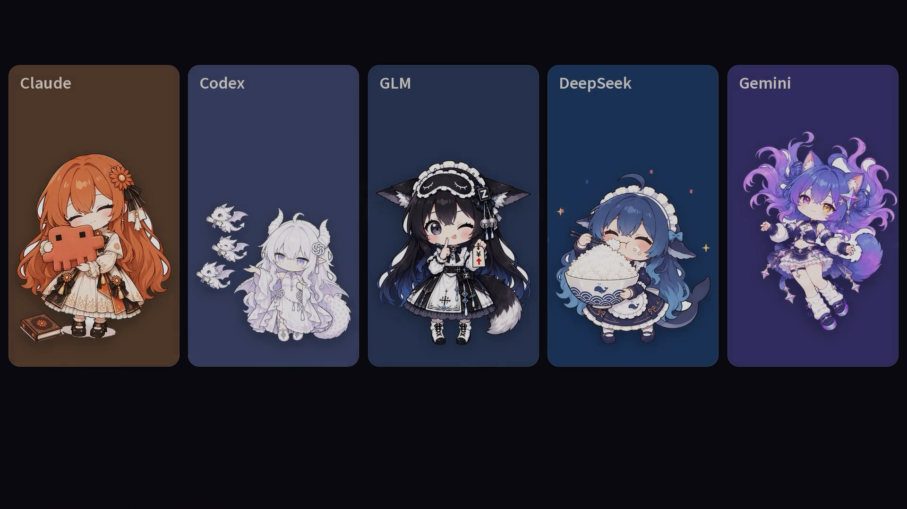
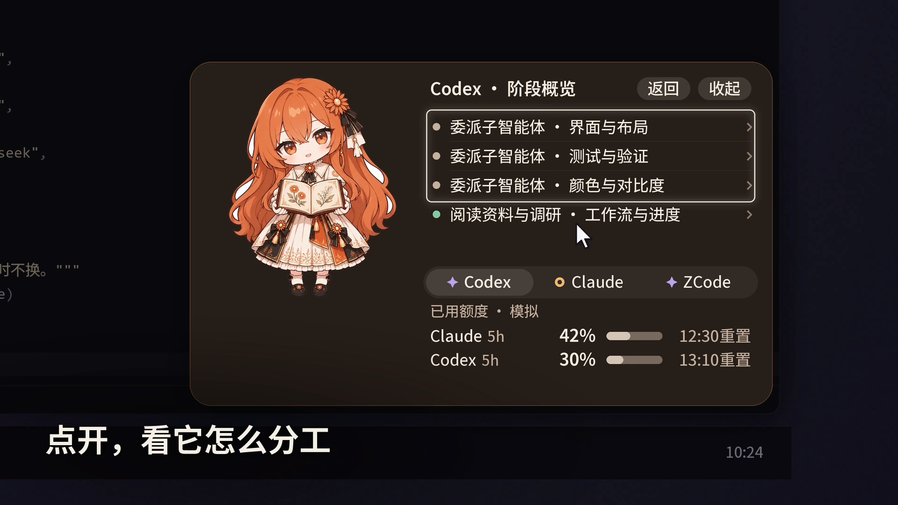
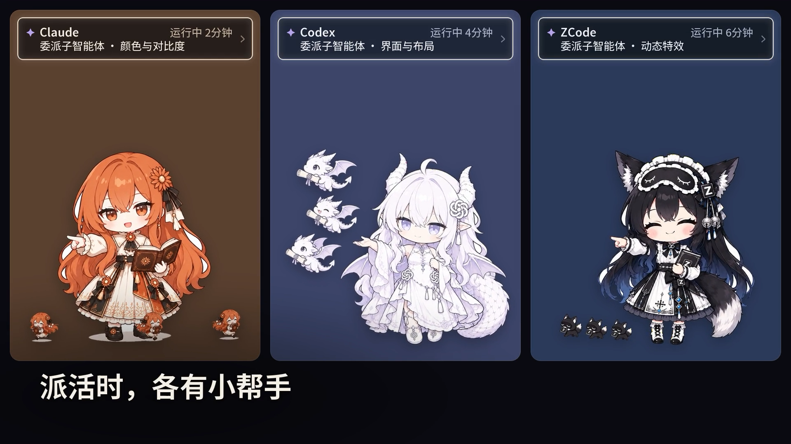

# AI 桌宠演示视频与图片

[返回项目说明](../../README.md) · **[观看完整视频](https://github.com/user-attachments/assets/c880d15e-7eaf-4cdc-a23d-11ee9215c8d1)** · [下载 1080p MP4](https://raw.githubusercontent.com/shuai9928/xiaoqiao-ai-desktop-pet/main/docs/media/demo.mp4) · [SRT 字幕](demo.srt)

https://github.com/user-attachments/assets/c880d15e-7eaf-4cdc-a23d-11ee9215c8d1

页面内为完整 720p 播放版；仓库中的 `demo.mp4` 保留 1080p 原片。

成片为 AI 桌宠介绍视频第五版：52.5 秒，1920×1080，30 fps，含旁白与画面字幕。视频、封面和截图随源码一起公开，获取文件无需下载密码。

## 视频截图

### 几个 AI 的状态放在一起

### 展开阶段概览

### 委派任务时的小帮手动画

图片均为成片的原始 1080p 视频帧。视频为离线渲染的功能演示：会话、额度和文件名均为模拟数据，桌面、应用窗口和任务栏为中性重绘，并非实际账号录屏。画面展示制作时的演示版本；本仓库源码基线是 I-52 分发版，具体功能与接入条件见项目说明和使用指南。

## 来源与署名

- AI 角色立绘与设定来自 [CrossPet 1.2.4](https://github.com/lokicorvus/crosspet)，适用 **CC BY-NC-SA 4.0（署名、非商用、相同方式共享）**。本视频及截图中的 AI 角色画面沿用此协议；保留 [角色完整署名](../../assets/characters/LICENSE.md)。
- 原型设定：DeepSeek「溟月」— 上善无形；深蓝女仆鲸鱼娘、御姐白龙 — B 站 ZipZipPipe。其他署名按上游记录保留，不推定未明确记载的作者。
- 小乔模式素材与本项目其他角色、美术的公开分发范围见 [ASSET_LICENSES.md](../../ASSET_LICENSES.md)，不将其重新许可为 MIT。
- 配乐与音效：本项目用程序合成。配音：曼波 AI 声线，由 MiloraAPI 公开免费接口生成；此为来源记录，不将第三方声音或服务输出重新许可为 MIT。
- 非官方同人项目，与 Anthropic、OpenAI、Google、DeepSeek、智谱、腾讯无关；Claude、Codex、ChatGPT、ZCode、GLM、Gemini、DeepSeek 等名称属于各自权利人。
- 源码的 [MIT LICENSE](../../LICENSE) 不覆盖第三方图像、角色设定和音频。复用角色画面时须遵守对应素材许可。
